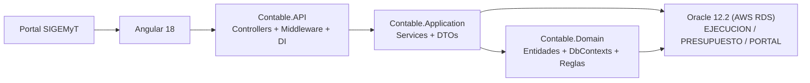

# LLM.md - Modulo Contable SIGEMyT

Documento vivo para onboarding tecnico (personas) y contexto operativo (LLMs).

- Proyecto: `Modulo-Contable-Sigemyt`
- Solucion: `Contable.sln`
- Stack principal: `.NET 8`, `ASP.NET Core Web API`, `EF Core 9 + Oracle`, `JWT`
- Front: `Angular 18` + `Material 18` + `Bootstrap 5` + `SweetAlert2`
- Ultima actualizacion: `2026-08-21`

> **Este modulo reemplaza a `admfincoys`, que es WebForms + PL/SQL.** La decision fue no llamar a
> los packages de Oracle sino **reimplementar las reglas en C#**. Eso significa que cada regla
> portada puede divergir del comportamiento historico, y por eso hay dos cosas que no son opcionales:
>
> | Donde | Que hay |
> |---|---|
> | `Contable.Domain/Reglas/` | Las 24 reglas de negocio, sin dependencias de infraestructura |
> | `Contable.Tests` | 225 tests que las cubren, incluidos los casos que documentan desviaciones deliberadas |
> | `_analisis/REGLAS.md` | Trazabilidad `PL/SQL -> Regla -> test` y el catalogo de 32 defectos del sistema viejo |
> | `_analisis/paridad/` | Arnes de paridad que corre el PL/SQL y el C# sobre la misma entrada |
>
> Corre `dotnet test Contable.sln` antes de cada merge. Si tocas una regla, tocala en
> `Contable.Domain/Reglas/` y no dentro del servicio.

---

## 1) Proposito y alcance

Implementa la parte contable del sistema municipal:

- Plan de cuentas (arbol de cuentas contables, alta/baja/modificacion).
- Matriz contable (equivalencia entre partidas presupuestarias y cuentas contables).
- Asientos (carga manual, anulacion, reversa, cierre y apertura de ejercicio).
- Reportes: Libro Diario, Mayores y Sumas y Saldos.
- Estadisticas y auditoria de consistencia, que **no existen en el sistema viejo**.

Fuera de alcance: presupuesto, tesoreria y libro banco. El modulo guarda `ID_CUENTA_BANCARIA` en el
renglon pero **no genera el movimiento de `T_LIBRO_BANCO`** que si hacia el PL/SQL: es una escritura
en el dominio de Tesoreria y merece su propia decision.

---

## 2) Arquitectura por capas

| Capa | Proyecto | Responsabilidad |
|---|---|---|
| API | `Contable.API` | Endpoints HTTP, middleware, DI, health checks |
| Application | `Contable.Application` | Servicios, DTOs, respuestas estandar |
| Domain | `Contable.Domain` | Entidades, DbContexts, **Reglas** |
| Tests | `Contable.Tests` | xUnit + FluentAssertions + EF Core InMemory |

Dependencias: `API -> Application -> Domain`. `Domain` no depende de nadie.



### Flujo estandar de request

1. El `Controller` recibe el request y delega en un `I*Service`.
2. El servicio resuelve datos con EF Core y aplica las clases de `Reglas`.
3. El resultado vuelve como `OperationResponse<T>`.
4. `BaseController.Return` traduce `Code` a `IActionResult` (200, 400, 404, 500).

---

## 3) Clases base y contratos clave

### `BaseController` (`Contable.API/Controllers/BaseController.cs`)

Trae `[Route("api/[controller]")]` y el metodo `Return<T>` que mapea el `Code`. Todos los
controllers heredan de el.

### `BaseService` (`Contable.Application/Services/BaseService.cs`)

Recibe los tres `DbContext`, el `IHttpContextAccessor` y el `IMemoryCache`. Expone:

| Metodo | Que devuelve |
|---|---|
| `GetUserCache()` | `NombreUsuario` del token |
| `GetIdUsuario()` | `IdUsuario` |
| `GetJurisdiccionCache()` | `IdJurisdiccion` |
| `GetUnidadAdministrativa()` | `IdUnidadAdministrativa` |
| `GetIdVigencia()` | `IdVigencia` |
| `GetSecuencia(contexto, nombre)` | Proximo valor de una secuencia Oracle |
| `Ok` / `Paginado` / `NotFound` / `BadRequest` | Constructores de `OperationResponse<T>` |

**El ejercicio y la jurisdiccion salen del token, nunca del request.** Un cliente que mande otro
`IdVigencia` no cambia nada: se descarta. Es la misma regla que tenia el PL/SQL.

### `OperationResponse<T>`

`{ success, message, data, code, totalRows, exception, exceptionDetails }`. Es el unico contrato de
salida. El front lee siempre `success` y `data`.

---

## 4) Mapa de datos y contextos Oracle

| Contexto | Esquema | Que se usa |
|---|---|---|
| `EjecucionContext` | `EJECUCION` | `T_CUENTAS_CONTABLES`, `T_ASIENTOS`, `T_ASIENTOS_DET`, `T_MATRIZ_CONTABLE`, `T_TIPOS_ASIENTO` |
| `PresupuestoContext` | `PRESUPUESTO` | `VIGENCIAS`, `JURISDICCIONES`, objetos de gasto y recursos. **Solo lectura.** |
| `PortalContext` | `PORTAL` | Usuarios, para emitir el token del modulo |

> **Regla dura del proyecto: no se escribe en `PRESUPUESTO`.** Ni vigencias ni jurisdicciones. El
> modulo solo escribe en las tablas contables de `EJECUCION`.

### Traduccion de jurisdiccion entre ejercicios

El `ID_JURISDICCION` **cambia de un ejercicio a otro** para la misma jurisdiccion real. Lo que se
mantiene es `NUMERO_JURISDICCION`. Ejemplo real de Morteros: la jurisdiccion numero 1 ("TRASUS") es
el id `4000` en 2024, el `10` en 2025 y el `2437` en 2026.

Cualquier consulta que cruce ejercicios (saldos anteriores, comparacion interanual, apertura) tiene
que traducir por numero, no por id. Es la fuente de error mas facil de cometer en este modulo.

---

## 5) Las reglas de negocio

Estan en `Contable.Domain/Reglas/`, sin dependencias de EF ni de ASP.NET, para poder probarlas
solas.

| Clase | Que define |
|---|---|
| `CodigoCuenta`, `ReglasProximoCodigo` | Formato del codigo por nivel y calculo del proximo hueco libre |
| `ReglasJerarquiaCuentas`, `ArbolDeCuentas` | Armado del arbol por `ID_CTA_CONTABLE_REL` y deteccion de anomalias de estructura |
| `ReglasMatrizContable`, `ReglasImportacionMatriz` | Unicidad de la relacion y traida del ejercicio anterior |
| `ReglasBalanceAsiento`, `ReglasAsiento`, `ReglasContrapartida` | Partida doble, redondeo y contrapartida sugerida |
| `ReglasCierreEjercicio` | Asientos de cierre y de apertura, parametrizados |
| `ReglasSumasYSaldos`, `ReglasMayor` | Consolidacion por rama y saldo corrido |
| `ReglasImportesAtipicos` | Deteccion de importes fuera de lo habitual (mediana + MAD) |
| `ReglasSugerenciaDeImputacion` | Cuentas propuestas al cargar, con su motivo |
| `ReglasAuditoria`, `ReglasDuplicados` | Catalogo de los 10 controles y deteccion de duplicados |
| `ReglasImportacionPlanDeCuentas` | Carga masiva del plan: evalua el archivo contra el plan actual y arma el orden de alta |

### Constantes que se prestan a confusion

`T_CUENTAS_CONTABLES` usa **dos convenciones de marca distintas en la misma tabla**:

```csharp
public const string CuentaActiva = "A";     // ACTIVA usa 'A' / 'I'
public const string CuentaInactiva = "I";
public const string MarcaSi = "S";          // IMPUTABLE, AUXILIAR, etc. usan 'S' / 'N'
public const string MarcaNo = "N";
```

Filtrar `ACTIVA == "S"` devuelve cero filas y parece un problema de datos. Esta cubierto por
`MarcasDeCuentaTests` justamente para que no vuelva a pasar.

### `EsHoja` y no `Imputable` para los totales

En `ReglasSumasYSaldos`, el total se suma sobre `EsHoja`, no sobre `Imputable`. Hay 3 cuentas
marcadas como imputables **que ademas tienen hijas**: sumar por `Imputable` las contaba dos veces y
descuadraba el balance en 358.931,09.

---

## 6) Trampas de EF Core contra Oracle 12.2

Estas ya costaron tiempo. No las repitas.

| Sintoma | Causa | Que hacer |
|---|---|---|
| `ORA-00904: "FALSE"` | `Any()`, `AnyAsync()` o `Contains()` sobre subconsulta. El proveedor los traduce a un literal booleano, que Oracle solo soporta desde 23c | `Take(1).CountAsync() > 0`, o un `LEFT JOIN` |
| Consultas lentas sin razon aparente | La base esta en **AWS us-east-2**: ~180 ms por ida y vuelta | Lo que manda es la **cantidad de consultas**, no el volumen de filas. Resolver los agregados con subconsultas escalares dentro de la misma consulta |
| Un filtro "en memoria" que rompe la paginacion | Filtrar despues de `Skip/Take` | El filtro va **dentro** de la consulta, siempre |

---

## 7) Mapa funcional (Controller -> Service)

| Controller | Service | Endpoints principales |
|---|---|---|
| `SeguridadController` | `SeguridadService` | `Login?atoken=&idJur=` — **la puerta de entrada real** |
| `LoginController` | `JwtService` | `CrearTokenAdmin`, `GetDataToken` |
| `DiagnosticoController` | `DiagnosticoService` | Estado del modulo y de la conexion |
| `PlanDeCuentasController` | `PlanDeCuentasService` | Arbol, alta, edicion, baja, buscador, `Importar` (carga masiva) |
| `MatrizContableController` | `MatrizContableService` | Listado, alta, baja, importacion del ejercicio anterior |
| `AsientosController` | `AsientoService` | `Buscar`, `Tipos`, alta, `Reversar`, `Anular`, `PlanCierre` |
| `ReportesController` | `ReportesService` | `SumasYSaldos`, `LibroDiario`, `Mayores` |
| `EstadisticasController` | `EstadisticasService` | `Tablero`, `Actividad`, `Cuentas`, `Calidad`, `SugerirCuentas`, `RevisarImporte` |
| `AuditoriaController` | `AuditoriaService` | Los 10 controles agrupados por severidad |

---

## 8) Operacion y runtime

### Pipeline

`ServicesConfig.AddConfig` arma CORS, Swagger, JWT, DI, los tres `DbContext` y los health checks.
`GlobalExceptionHandlingMiddleware` convierte cualquier excepcion no manejada en un
`OperationResponse` con `code 500`, sin filtrar el stack al cliente.

### Health checks

Uno por contexto: `DatabaseEjecucionHealthCheck`, `DatabasePresupuestoHealthCheck`,
`DatabasePortalHealthCheck`.

### Build y despliegue

- `build-api.cmd` -> `dist/` del repo de la API. Corre la suite antes de publicar; si hay tests en rojo no genera
  el paquete, y quita `appsettings.Development.json` del resultado porque tiene credenciales.
- `build-web.cmd` -> `publicar/` del repo del front. Usa `npm ci` y `ng build --configuration production`.
- Son `.cmd` y no `.ps1` porque la directiva de grupo esta en `AllSigned` y un `.ps1` sin firmar no
  corre ni con `-ExecutionPolicy Bypass`.
- Ojo con `errorlevel` dentro de un bloque entre parentesis en batch: se resuelve al parsear y
  siempre da el valor anterior. Dentro de bloques va `!errorlevel!` con `enabledelayedexpansion`,
  que es lo que hace que la guarda de tests realmente aborte.
- Detalle completo en `DESPLIEGUE.md`.

---

## 9) Seguridad y configuracion (sin secretos)

### Como se entra al modulo

**El Portal SIGEMyT federa la sesion por querystring, no por `sessionStorage`.** Este modulo
arranco implementando el mecanismo de Tesoreria —leer `usuario` y `token` de `sessionStorage`— y
con eso el Portal real lo rebotaba: no encontraba identidad y redirigia al Portal, que devolvia al
modulo, en un bucle sin ningun mensaje.

El contrato de la plataforma, el mismo para los doce modulos:

```
1. El usuario entra al Portal      POST api/Seguridad/ValidarUsuario  -> { token, usuario }
2. Clickea el modulo               <url del modulo>?token=...&idJur=...&numJur=...
3. El front llama a su backend     GET  api/Seguridad/Login?atoken=...&idJur=...
4. Ese backend llama al Portal     GET  {Portal:AuthUrl}?atoken=...
5. El Portal responde              200 { token, usuario { ..., jurisdiccionId, rolesX } } | 401
```

El token del Portal es **opaco**: `SeguridadService` lo reenvia tal cual y no lo desencripta nunca.
Lo que el modulo devuelve al front no es ese token sino el suyo propio, con jurisdiccion, unidad
administrativa y vigencia ya resueltas en los claims.

`sessionStorage` sigue existiendo como respaldo en `app.component.ts`, para no romper nada que
hubiera estado funcionando asi.

Dos detalles que importan:

- **`idJur` del Portal se traduce, no se usa directo.** El Portal manda la jurisdiccion del
  ejercicio donde esta parado el usuario —en Morteros llega `idJur=4000`, que es de 2024/2025— y
  `JwtService` la traduce por `NUMERO_JURISDICCION` a la vigencia activa (2437). Usarla tal cual
  filtraria todo por un ejercicio viejo.
- **El token se borra de la URL** apenas se lee (`history.replaceState`). Es una credencial: no
  tiene por que quedar en el historial, en el `Referer` ni en lo que el usuario copie para pedir
  ayuda.

Cuando el ingreso falla, la pantalla muestra el motivo y **no** redirige. Rebotar al Portal ante
cualquier fallo es lo peor posible para diagnosticar. La excepcion es una **sesion guardada que
vencio**: ahi si se vuelve al Portal, y no hace bucle porque el Portal manda de nuevo con `?token=`.

### La trampa de `UseAuth`

`Uses:UseAuth` esta en **false** en desarrollo y en **true** en produccion. Con `true`,
`SetFallbackPolicy(RequireAuthenticatedUser)` exige token en **todo** endpoint que no tenga
`[AllowAnonymous]`. Eso hace que haya una clase entera de bugs que **no se ven en desarrollo**:

- `Login/GetDataToken` no esta marcado como anonimo, y el interceptor del front lo excluia de
  mandar el header "porque es del login". En produccion daba 401 y el usuario no entraba nunca.
  Hoy el interceptor solo excluye lo que de verdad emite el token: `Seguridad/Login` y
  `Login/CrearTokenAdmin`.

**Si tocas autenticacion, probalo con `UseAuth: true`.** Es la unica forma de reproducir produccion:
con `false` todo pasa sin credencial y el bug queda escondido.

### La sesion sobrevive al F5

El token del modulo se guarda en `sessionStorage` bajo la clave `contable.token`. Sin eso vivia
solo en memoria y **cualquier recarga expulsaba al usuario al Portal**. Va en `sessionStorage` y no
en `localStorage` porque muere al cerrar la pestaña, que es la vida que le corresponde a una
credencial de sesion. La clave lleva prefijo porque el Portal y los otros modulos comparten origen
y usan `token` y `usuario` para lo suyo.

### Claims que usa el negocio

`IdUsuario`, `NombreUsuario`, `IdPersona`, `DNI`, `Cuil`, `IdJurisdiccion`,
`IdUnidadAdministrativa`, `IdVigencia`, `Roles`.

### Flags (`Uses`)

| Flag | Que hace |
|---|---|
| `UseJwt` | Registra el esquema de autenticacion |
| `UseAuth` | Exige usuario autenticado en todos los endpoints. **En desarrollo esta en `false`** |
| `UseSwagger` | Publica la UI de Swagger |

### Parametros contables (`Contabilidad`)

| Clave | Para que |
|---|---|
| `CuentaBalanceoCierre` | Cuenta contra la que balancea el cierre. Morteros: `10176` (`03.01.04.01`) |
| `UnidadAdministrativaCierre` | UA con la que se graban los asientos de cierre. Morteros: `1614`, **no `1619`** (ver abajo) |
| `NaturalezasResultado` / `NaturalezasPatrimoniales` | Que naturalezas se cancelan y cuales arrastran saldo |
| `TipoAsientoCierre` / `TipoAsientoApertura` | Tipos con los que se graban |
| `IncluirAnuladosEnSaldos` | El PL/SQL los incluia siempre porque el filtro estaba comentado |

### Checklist de hardening

- [ ] `UseAuth` en `true` en homologacion y produccion.
- [ ] `Jwt:SecretKey` distinta por ambiente y fuera del repositorio.
- [ ] `Cors:AllowedOrigins` con la URL real del front, sin comodines.
- [x] ~~`Login/GetDataToken` recibe el token por query string~~ — resuelto el 2026-08-21: lee los
      claims del principal autenticado y el token va en el header `Authorization`.
- [ ] `Portal:AuthUrl` cargado. **Sin esto no entra nadie**, y el servidor de la API tiene que poder
      salir hacia el Portal.
- [ ] Angular 18 tiene una vulnerabilidad XSS alta sin correccion dentro de la misma major
      (`GHSA-jj27-h5hq-8x99`). Decidir si se sube de major antes de produccion.

---

## 10) Guia rapida para LLMs y contributors

### Si tenes que tocar...

| Tarea | Donde |
|---|---|
| Una regla contable | `Contable.Domain/Reglas/` + su test. **Nunca dentro del servicio** |
| Un endpoint nuevo | Controller + interfaz + implementacion + registro en `ServicesConfig.AddInternalServices` |
| Una consulta lenta | Contar round trips antes de optimizar filas. Ver §6 |
| Algo que cruce ejercicios | Traducir jurisdiccion por `NUMERO_JURISDICCION`. Ver §4 |
| Una pantalla | `web/src/app/views/`, ruta en `app.routes.ts`, item en `navbar.component.ts` |
| El manual de usuario | `web/src/app/views/manual/` — si agregas una seccion, agregala tambien al indice del `.ts` |
| Exportacion de un reporte | `web/src/app/services/reportes-exportables.ts`. `ExportarService` no se toca |

### Antes de leer un package del sistema viejo

`all_arguments` **no lista** los procedimientos declarados dentro de `/* */` en el spec pero
implementados en el body. `EDITAR`, `BUSCARSIGNUM`, `INSERTAR_ASIENTO_CIERRE` e
`INSERTAR_ASIENTO_APERTURA` estan en ese caso. Lee siempre `all_source`.

### Trampas del front

| Sintoma | Causa |
|---|---|
| Algo funciona con `ng serve` y falla en el paquete publicado | El build de desarrollo no optimiza y sintetiza la interoperabilidad CommonJS. `exceljs` es CJS: en desarrollo `modulo.Workbook` existe, en produccion el chunk exporta **solo** `default` y queda `undefined`. Hay que tomarlo de `default`. **Probar exportaciones contra `publicar/`, no contra `ng serve`** |
| Texto invisible en tema oscuro | Bootstrap deja `color: rgb(33,37,41)` heredado en el `body`. Poner `color: var(--text-primary)` explicito |
| Celdas de tabla en blanco sobre blanco | Bootstrap fija `--bs-table-color` y `--bs-table-bg`. Se redefinen esas variables en `.table`, no se pelea con selectores |
| Una tarjeta baja se hunde en una fila flex | El `.card` global usa `margin: auto`. Poner `margin-top: 0` |
| Un template literal roto que igual compila | **Nunca editar TS con `perl -pi`**: interpola `${...}` y destruye el literal |
| Una fecha que sale un dia adelantada | `toISOString()` devuelve UTC y en Argentina (UTC-3) despues de las 21:00 da el dia siguiente. Usar `getFullYear()/getMonth()/getDate()` |
| Un callback que no redibuja | `IntersectionObserver` no lo parchea zone.js: hay que volver a entrar con `NgZone.run` |

### Checklist minimo antes de merge

- [ ] `dotnet build Contable.sln` sin errores ni warnings.
- [ ] `dotnet test Contable.sln` en verde (225 tests hoy).
- [ ] `npx ng build` sin errores, incluidos los presupuestos de tamano.
- [ ] Si tocaste un reporte, correr el arnes de paridad de `_analisis/paridad/`.
- [ ] Si agregaste una regla, agregarla a la tabla de trazabilidad de `_analisis/REGLAS.md`.

---

## 11) Puntos de atencion actuales

1. **Los parametros del cierre son especificos de Morteros.** `CuentaBalanceoCierre = 10176` y
   `UnidadAdministrativaCierre = 1614`, confirmados el 2026-08-21. Para otro municipio hay que
   volver a averiguarlos.

   La UA tiene trampa: la que **se llama** "Municipalidad De Morteros" es la `1619` y pertenece a
   la jurisdiccion 2442, que no tiene ni una cuenta ni un asiento. Toda la contabilidad esta en
   2437 y 4000. El criterio correcto es el **numero** de la UA, que es lo que
   `JurisdiccionDeUnidad` traduce entre ejercicios: la de numero 1 (`1614`) resuelve a 2437 en 2026
   y a 4000 en 2025.

   Limitacion: la configuracion guarda un **id de cuenta global** y los ids estan alcanzados por
   jurisdiccion. Si algun ejercicio futuro crea una jurisdiccion nueva con su propia cuenta de
   resultado, hay que pasar a resolverla por **codigo** en vez de por id.
2. **El mayor de todas las cuentas tarda unos diez segundos**: arma 155 mayores en una respuesta.
   Conviene paginarlo o exigir cuenta antes de produccion.
3. **El tema oscuro no esta auditado en las pantallas anteriores a la fase 7.** Se corrigio el
   origen para tablas y para el arbol del plan, pero falta recorrer matriz, asientos y reportes.
4. **`exceljs` arrastra una vulnerabilidad moderada por `uuid`.** Es transitiva y solo corre en el
   navegador al exportar; evaluar al actualizar dependencias.
5. **El libro banco no esta conectado** (ver §1).

---

## 12) Referencias internas

| Archivo | Que tiene |
|---|---|
| `PLAN.md` | Las 9 fases del proyecto y su estado |
| `README.md` | Que quedo funcionando en cada fase y la deuda conocida |
| `DESPLIEGUE.md` | Como se compila y se publica cada pieza |
| `_analisis/REGLAS.md` | Trazabilidad de reglas y catalogo de 32 defectos |
| `_analisis/plsql/` | Los 7 packages originales extraidos (11.449 lineas) |
| `_analisis/paridad/` | Arnes de comparacion contra el PL/SQL |
| `_datos-de-prueba/` | Generacion, verificacion y limpieza de los datos sinteticos `[QA]` |
